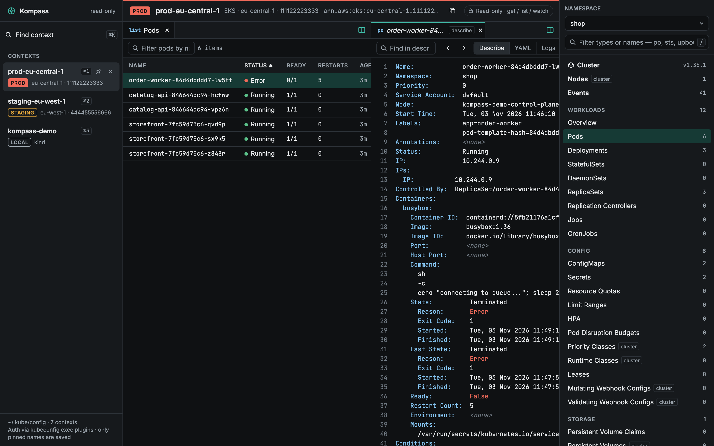
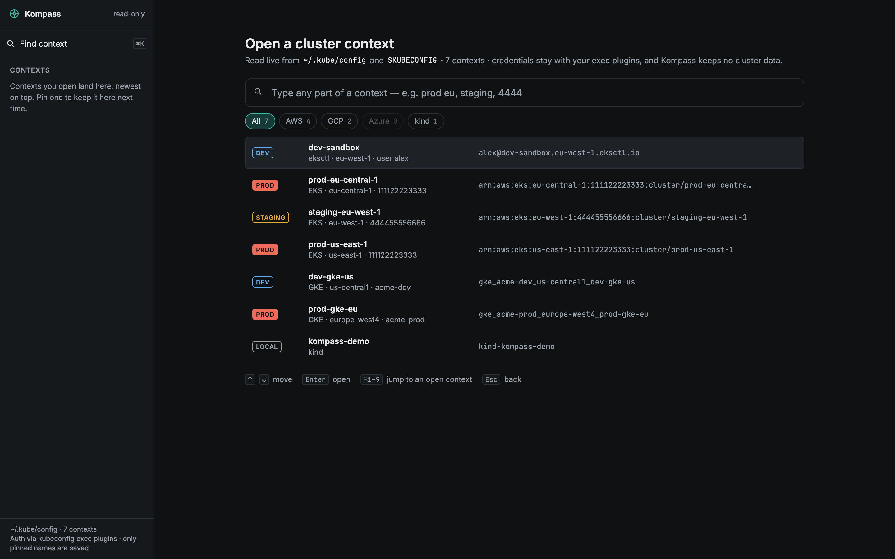

# Kompass

A **read-only** Kubernetes desktop navigator for macOS, built for jumping between many clusters fast during an incident. It answers one question: *how quickly can I get from "something is wrong in prod EU" to the YAML that explains it?*

> [!IMPORTANT]
> **This project is AI-generated.** The design was made with Claude Design, and all of the code, tests and docs were written by Claude (Anthropic's AI model) in Claude Code. A human directed it, tested it against real clusters and reviewed the results. Read the code before you point it at clusters you care about. The read-only guarantees below are enforced in code and covered by tests, but they're only as good as that code.



<sub>Screenshots use a local kind cluster with made-up context names and the AWS documentation account IDs (`111122223333`).</sub>

## Features

- **Fast context switching.** All your kubeconfig contexts are searchable with multi-term search (`prod eu`), with AWS / GCP / Azure / kind filters. Long names are shortened (EKS ARNs, `gke_project_zone_name`, eksctl, Teleport) and get an environment chip (prod, staging, dev, local) derived from the name. Prod contexts get a red strip, so you always know where you are.
- **A workspace per context.** Each open context keeps its own namespace, filters, tabs and split editor. ⌘1–9 switches the whole workspace, not just the API target. Pin contexts to keep them in the rail across restarts.
- **Everything the API server serves.** The right nav is built from discovery, so each cluster shows exactly what it has: built-in categories, Custom Resources grouped by API group, and everything else under Uncategorized, with live counts.
- **Live tables.** List tabs are informer-backed and update as the cluster changes. Sort by any column; Status sorts by severity, so broken pods come first. Pod status, Ready and Restarts match `kubectl get pods`, including native sidecars.
- **Describe, YAML and Logs.** Describe uses kubectl's own describers, so the output matches the terminal. YAML hides `managedFields`. Logs follow the stream, with a container picker (sidecars and init containers included), tail size, and the previous instance's logs (what a crash-looping container printed). All three views have find (⌘F, Enter / Shift+Enter).
- **Split editor.** ⌘\ splits the editor 50/50 like VS Code. Drag the divider, or drag tabs between the groups. In a split, clicking a list row opens it in the other group.
- **Cluster overview.** Control-plane and kubelet versions (skew is flagged), node types (provisioner, pool, instance type, spot or on-demand, OS image, AMI where exposed), and the versions of well-known add-ons (CNI, CoreDNS, kube-proxy, CSI drivers, Karpenter, Istio, cert-manager, ingress-nginx and more).
- **Helm and Secrets, safely.** Helm releases are decoded in memory from their release secrets, with values hidden. Secret values are masked; reveal one key at a time.



## Read-only by construction

- **Only reads reach the cluster.** Every client is built from one config whose transport rejects anything that isn't a plain `GET` or `HEAD`, before the request leaves the process. That covers create, update, patch, apply, delete and scale, plus connection upgrades and the `exec`, `attach`, `portforward` and `proxy` subresources. [`guard_test.go`](app/internal/kube/guard_test.go) sends each of those through the app's real config path and checks that none of them reach the server.
- **Your kubeconfig is untouched.** It's loaded the way kubectl loads it (`$KUBECONFIG`, else `~/.kube/config`), and Kompass never writes to it or changes `current-context`. Auth goes through your kubeconfig's exec plugins (`aws eks get-token`, `gke-gcloud-auth-plugin`, Teleport, …), and tokens stay in memory.
- **Almost nothing is stored.** Cluster data, logs and secret values live only in memory. The one file Kompass writes is the list of pinned context *names*, at `~/Library/Application Support/Kompass/pinned.json`. Delete it to reset the rail.

## Install

Kompass isn't distributed as a binary yet; you build it from source. It's developed and tested on macOS (Apple Silicon).

**Requirements**

- [Go](https://go.dev/dl/) 1.26 or later
- [Node.js](https://nodejs.org/) 18 or later
- The [Wails v2 CLI](https://wails.io/docs/gettingstarted/installation):

```bash
go install github.com/wailsapp/wails/v2/cmd/wails@v2.12.0
```

- Xcode Command Line Tools (`xcode-select --install`). Run `wails doctor` to check everything is in place.
- Whatever auth plugins your kubeconfig uses (`aws`, `gke-gcloud-auth-plugin`, …), on your shell's `PATH`.

**Build and install**

```bash
git clone https://github.com/CariZa/kompass.git
cd kompass/app
wails build -m
ditto build/bin/kompass.app /Applications/Kompass.app
open /Applications/Kompass.app
```

`-m` skips `go mod tidy`, which tries to fetch test-only dependencies of kubectl and can time out on a flaky network.

To keep it in the Dock, right-click its icon while it's running and choose **Options → Keep in Dock**. Copying it to `/Applications` matters: `wails dev` rewrites `build/bin`, which would leave a Dock icon pointing at `build/bin` broken. To update, quit Kompass, rebuild and run the `ditto` command again.

Apps started from Finder or the Dock don't get your shell's environment. At startup Kompass asks your login shell for `PATH` and `KUBECONFIG`, so exec auth plugins are found either way.

## Keyboard shortcuts

| Keys | Action |
|---|---|
| ⌘K | Find a context |
| ⌘1–9 | Switch to a context in the rail (connects a pinned one) |
| / | Filter resource types (and names in loaded lists) |
| ⌘F | Find in Describe, YAML or Logs |
| Enter / Shift+Enter | Next / previous match |
| ⌘\ | Split or join the editor |
| ↑ ↓ Enter | Move and open on the context picker |
| Esc | Back, or clear a filter |

## Run locally

With the requirements above installed, you can run Kompass straight from a checkout without installing it:

```bash
git clone https://github.com/CariZa/kompass.git
```

```bash
cd kompass/app
```

```bash
wails dev -m
```

The first run installs the frontend's npm dependencies, then opens the app window with live reload. It reads the same kubeconfig as kubectl (`$KUBECONFIG`, else `~/.kube/config`). The dev server at http://localhost:34115 also works in a browser, with the Go bindings live. Point it at a specific kubeconfig with `KUBECONFIG=... wails dev -m`.

**Tests**

```bash
cd app
go test ./...
```

The integration tests run against a real cluster and are behind a build tag. Use a throwaway kind cluster with its own kubeconfig, so your real config isn't touched:

```bash
kind create cluster --name kompass-test --kubeconfig /tmp/kind.kubeconfig
KUBECONFIG=/tmp/kind.kubeconfig KOMPASS_IT_CONTEXT=kind-kompass-test go test -tags integration ./internal/kube/
```

The fixtures they expect are listed at the top of [`integration_test.go`](app/internal/kube/integration_test.go). `TestPodColumnsMatchKubectl` (in the same file) compares Kompass's pod columns with `kubectl get pods -A` on any context, and only reads.

**Layout**

| Path | What's there |
|---|---|
| `app/main.go`, `app/app.go` | Wails entry point and the methods the frontend calls |
| `app/internal/kube/` | Contexts, the read-only guard, discovery, live lists, describe, YAML, logs, Helm, cluster details |
| `app/internal/pins/` | The pinned-context store |
| `app/frontend/src/` | Vanilla TypeScript UI |
| `kompass-design/` | The original design: spec, handoff notes, tokens and clickable mockups (sample data is fictional) |

## Limitations

- **macOS only, for now.** Wails supports Linux and Windows, but Kompass hasn't been tried there, and the login-shell environment import is aimed at macOS.
- **No pop-out windows yet.** Pop-outs need Wails v3's multi-window support, which is still in beta.
- **Read-only by design.** There's no exec, port-forward, edit, scale or delete, and there won't be.
- **The Workloads overview is just counts for now.**

## License

[MIT](LICENSE)
